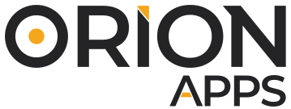

# Welcome

  
  

  <strong>Powered by</strong> 
  
    
    
  

Orion Apps is the catalog built for Orion. Pick an app, fill in a form, and Orion sets up the rest. It is an app store of Helm charts from Git, with 50+ official templates today. You can also install any Terra-compatible Helm chart from your own repository.
Apps can range from dashboards, workload templates, services, and even software installers.
 
## What you get
 
- **50+ official templates.** From Jupyter and Hermes to Deadline, KubeVirt, MetalLb, and Helios.
- **Install from a form.** Users fill in values and Orion deploys the chart. No Dockerfile, no YAML, no dependency chase.
- **Your own charts.** Point Orion Apps at your own Git repository, pinned to a branch or release tag. Internal charts get the same install as the official catalog. Most Helm charts become Terra-compatible with minimal effort.
- **Bundles.** Install a whole kit, like KubeVirt, at once.
- **Helm and ArgoCD underneath.** Charts are kept in sync from Git by ArgoCD. Users never see either.
Examples from the catalog: Jupyter, vLLM, Open WebUI, Hermes Agent, Claude Code, Deadline 10, Helios, and KubeVirt. Browse the full list under [Plugins](https://docs.juno-innovations.com/Terra-Official-Plugins/plugins/AI/hermes-agent/).

## Build your own plugin
 
Plugins live in Git repositories that Orion reads. To add an app to your own catalog or contribute to the official one, start with [Building Plugins](https://docs.juno-innovations.com/Terra-Official-Plugins/repositories/).
 
The plugin repository ships an [AGENTS.md](https://github.com/juno-fx/Terra-Official-Plugins/blob/main/AGENTS.md). Point your coding agent at it and it follows the same rules our team uses, from the folder layout to the form fields an admin fills in. Orion also has an MCP server, so your AI agents can work with Orion.
 
Share what you build. Open a pull request to add your installer to the community catalog, or keep it in a private Git repository that only your Orion install reads.
 
## Scope
 
Orion Apps installs onto Orion clusters. Orion is customer-hosted, so apps run on your infrastructure.
 
## Get started
 
- [Building Plugins](https://docs.juno-innovations.com/Terra-Official-Plugins/repositories/)
- [Plugin catalog](https://docs.juno-innovations.com/Terra-Official-Plugins/plugins/AI/hermes-agent/)
- [Orion Documentation](https://docs.juno-innovations.com/Orion-Documentation/latest/)
- [Helios Documentation](https://docs.juno-innovations.com/Helios/)