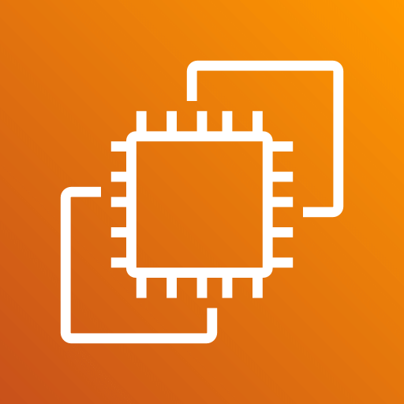

# Crossplane EC2



**Category:** Virtual Machine
**Type:** Workload Template
**Tags:** `virtualization` · `virtual-machine` · `crossplane` · `AWS`
**Compatibility:** `genesis-deployment>=3.0.2` · `orion-deployment>=3.1.0`

---

## Overview

Crossplane EC2 is a workload template that provisions and manages AWS EC2 instances through the Juno platform, giving cloud VMs the same lifecycle management as containerised workstations. Once an instance is provisioned, endpoints like SSH and RDP are automatically discovered and surfaced in Hubble.

This plugin requires **Crossplane** and **Crossplane AWS Provider** to be installed first.

---

## How It Works

**Workload Template** — Installs the EC2 workload schema into Genesis. Once installed, the EC2 type appears in **Genesis** on the Workloads page, where it can be authored into a workload template. Users can then launch and provision AWS EC2 instances on demand within a project through **Hubble**.

---

## Prerequisites

- **Crossplane** plugin installed
- **Crossplane AWS Provider** plugin installed and configured with valid AWS credentials
- An AWS VPC, subnet, and security groups already configured in AWS
- For `load_balancer`: an AWS cloud provider in the cluster (built into EKS; elsewhere install the AWS Load Balancer Controller), and subnets tagged `kubernetes.io/role/internal-elb: 1` (internal) or `kubernetes.io/role/elb: 1` (internet-facing)
- For an `internal` load balancer: a network path from your users into the VPC (VPN, Direct Connect or peering)
- Platform versions: `genesis-deployment >= 3.0.2`, `orion-deployment >= 3.1.0`

---

## Installation

1. Install the **Crossplane** and **Crossplane AWS Provider** plugins first
2. Open **Terra** and navigate to the **Plugin Marketplace**
3. Search for **"Crossplane EC2"**
4. Click **Install**
5. Click **Confirm** to deploy (no install-time fields required)

Once installed, the EC2 schema is available in **Genesis**. From the Workloads page, author the template — users can then launch and provision EC2 instances on demand through **Hubble**.

---

## Configuration

### Install-Time Fields

No install-time configuration is required for this plugin.

### Workload Launch Fields

These fields are configured when authoring the workload template in **Genesis** and used each time a user provisions an EC2 instance through **Hubble**:

| Field | Details |
|-------|---------|
| `ami_image_id` | **string** · Required<br>AWS AMI image ID for the EC2 instance |
| `security_group_ids` | **list** · Required<br>List of AWS security group IDs to attach |
| `block_device_mappings` | **list** · Required<br>Block devices to attach (mount path + size in GB) |
| `subnet_id` | **string** · Required<br>AWS Subnet ID for the instance |
| `instance_type` | **string** · Required · Default: `t3.micro`<br>EC2 instance type (e.g. `t3.medium`, `m5.large`) |
| `delete_on_termination` | **boolean** · Required · Default: `true`<br>Whether to delete EBS volumes when the instance is terminated |
| `aws_private_subnet` | **boolean** · Required · Default: `false`<br>Set when the subnet has no public addressing. Kuiper brokers the exposed ports to the instance's private IP through a cluster Service: a `ClusterIP` Service, or a `LoadBalancer` Service when `load_balancer` is set. The cluster must be able to route to the VPC |
| `load_balancer` | **select** · Optional<br>Only used with `aws_private_subnet`. Exposes the instance through an AWS NLB:<br>• unset: no load balancer. The instance is reachable only from inside the cluster through a `ClusterIP` Service<br>• `internet-facing`: public NLB, for users connecting over the internet<br>• `internal`: private NLB, for users on a VPN, Direct Connect or peered network<br>Both NLB options are created by the cluster's built-in AWS cloud provider; the AWS Load Balancer Controller is not required. If the cluster's nodes have more than one security group attached, exactly one of them must be tagged `kubernetes.io/cluster/<cluster-name>` (value `owned` or `shared`), or the NLB fails to sync with `Multiple untagged security groups found for instance` |
| `ports` | **list** · Optional · Default: `22`<br>Ports to expose from the instance, so users can connect with clients other than SSH. Add one entry per port (e.g. `22` for SSH, `3389` for RDP, `8443` for NICE DCV). The instance's security groups must allow these ports. With a public subnet, allow them from your users. With `aws_private_subnet`, traffic reaches the instance from the cluster's nodes and pods, not from users, so allow them from the cluster's VPC CIDR or node security groups. Ports are fixed at launch. An empty list exposes nothing, and Hubble shows no connection.<br>Each entry has a `protocol` (`TCP` default, or `UDP`). A port number carries one protocol: for TCP and UDP, add two entries on different ports. UDP entries are brokered but not listed as Hubble connections, since clients connect over TCP and negotiate UDP themselves. See [NICE DCV with QUIC](#nice-dcv-with-quic) |
| `region` | **string** · Required<br>AWS region to launch the instance in (e.g. `us-east-1`) |
| `provider_config_ref` | **string** · Required · Default: `aws-provider-argocd-provider-config`<br>Name of the Crossplane ProviderConfig to use |
| `iam_instance_profile` | **string** · Optional<br>IAM instance profile name to attach to every instance launched from this template (e.g. `production-artists`). Leave blank for none. Amazon DCV seats need one, see below |

### IAM Instance Profiles

An instance profile gives software on the EC2 instance temporary AWS credentials from an IAM role, with no access keys on the machine. Anyone with a shell on the instance can use those credentials, so a profile should only allow what the template's users need.

Each workload template takes one profile, so access is split by template. Assign each template in Genesis to the users who should have that access. For example:

| Template | `iam_instance_profile` | Assigned to | Permissions |
|----------|------------------------|-------------|-------------|
| Artist Workstation | `production-artists` | production artists | DCV license, read/write on the project bucket |
| Admin Workstation | `admin-users` | admins | DCV license, plus the broader access admins need |

> **Amazon DCV seats need an instance profile.** On EC2, the DCV server reads its license from an AWS-owned S3 bucket. If the instance has no profile allowing that read, DCV can't find a license and refuses every sign-in. Attach the [DCV license policy](#example-dcv-license-policy) to every role that DCV templates use.

#### Creating a role in the AWS console

1. **IAM → Roles → Create role**
2. **Trusted entity type:** AWS service. **Service:** EC2. **Use case:** EC2. This sets the trust policy to `ec2.amazonaws.com` and creates an instance profile with the same name as the role. Don't pick the Spot Fleet or Scheduled Instances use cases: those roles are for AWS services, not for instances.
3. **Add permissions:** attach the policies the instance needs (see the examples below). You can also attach none and add them later. Running instances pick up policy changes within a few minutes, without a relaunch.
4. **Role name:** e.g. `production-artists`. Enter this name in the template's `iam_instance_profile` field.

If the template names a profile that doesn't exist, AWS rejects the instance and it never becomes ready.

#### Crossplane PassRole

Crossplane can only attach a role it is allowed to pass. Add this to the IAM identity used by the ProviderConfig, listing every role your templates use. Skip it if that identity already has admin-level access.

```json
{
  "Version": "2012-10-17",
  "Statement": [{
    "Effect": "Allow",
    "Action": "iam:PassRole",
    "Resource": [
      "arn:aws:iam::<account-id>:role/production-artists",
      "arn:aws:iam::<account-id>:role/admin-users"
    ]
  }]
}
```

#### Example: DCV license policy

Create this once as a customer managed policy (**IAM → Policies → Create policy → JSON**), named e.g. `dcv-license`, and attach it to every role that DCV seats use. The `*` in the bucket name covers every region.

```json
{
  "Version": "2012-10-17",
  "Statement": [{
    "Effect": "Allow",
    "Action": "s3:GetObject",
    "Resource": "arn:aws:s3:::dcv-license.*/*"
  }]
}
```

To confirm it worked, check `/var/log/dcv/server.log` on the instance. There should be no license errors, and sign-ins should go through.

The instance also needs network access to S3. In a private subnet without a NAT gateway, add an S3 gateway VPC endpoint (`com.amazonaws.<region>.s3`, free) to the subnet's route table. Without it, the license read fails even with the policy attached.

#### Example: project bucket access

For a role like `production-artists`, scope S3 access to the bucket or prefix the team works in, rather than attaching `AmazonS3FullAccess`:

```json
{
  "Version": "2012-10-17",
  "Statement": [
    {
      "Effect": "Allow",
      "Action": "s3:ListBucket",
      "Resource": "arn:aws:s3:::<bucket>"
    },
    {
      "Effect": "Allow",
      "Action": ["s3:GetObject", "s3:PutObject", "s3:DeleteObject"],
      "Resource": "arn:aws:s3:::<bucket>/<project>/*"
    }
  ]
}
```

#### Other useful policies

- **AmazonSSMManagedInstanceCore** (AWS managed): Session Manager shell access to the instance without opening SSH. Useful for debugging private-subnet instances.
- Avoid broad policies such as `AmazonS3FullAccess`, `PowerUserAccess` or `AdministratorAccess` on roles for non-admin templates. Anyone using the instance gets those credentials.

### NICE DCV with QUIC

DCV can carry sessions over QUIC (UDP), which holds up better than TCP on lossy or high-latency links. Through the load balancer, TCP and UDP can't share a port number, so QUIC runs on its own port:

1. In the AMI's `/etc/dcv/dcv.conf`, enable QUIC on a separate port and restart `dcvserver`:
   ```ini
   [connectivity]
   enable-quic-frontend=true
   quic-port=8444
   ```
2. In the workload template, expose both ports:

   | `port` | `protocol` |
   |--------|------------|
   | `8443` | `TCP` |
   | `8444` | `UDP` |

3. Allow TCP 8443 and UDP 8444 in the instance's security groups, from the same source as your other ports.

The DCV server tells the client which QUIC port to use, so a client with Transport on Auto picks QUIC and falls back to TCP on its own.

If QUIC is enabled on the server but UDP isn't exposed, a client on Auto tries UDP and hangs. Either expose the UDP port or set `enable-quic-frontend=false`.

### Instance Tags

The plugin tags every instance so the AMI's boot script can tell whose seat it is. The plugin only provides the data. Reading it and acting on it (e.g. creating the user or making them the DCV session owner) is up to your boot script.

| Tag | Value | When |
|-----|-------|------|
| `Name` | `<project>-<workload name>` | Always |
| `orion-owner` | Username of the Orion user who launched the workload, injected by Orion's Kuiper | Always |

The tags are applied as part of the launch, so they exist before the instance boots, and keep their values for its lifetime. They are visible to anyone who can view the instance in AWS, so never put secrets in tags.

#### Reading tags from the instance

The Crossplane AWS provider can set tags, but it can't turn on instance metadata tags for an instance, so a boot script can't read its tags from instance metadata by default. Use option 1. Option 2 works only if an account-wide setting is safe in your account.

**Option 1: the EC2 API (recommended)**

The boot script looks up its own tags with the AWS CLI, using the instance profile's credentials. This only affects instances using that profile.

1. Give the instance an [instance profile](#iam-instance-profiles) whose role allows `ec2:DescribeTags`. Add it to the role as an inline policy, e.g. `read-instance-tags`:
   ```json
   {
     "Version": "2012-10-17",
     "Statement": [{
       "Effect": "Allow",
       "Action": "ec2:DescribeTags",
       "Resource": "*"
     }]
   }
   ```
   `ec2:DescribeTags` can't be limited to specific instances, so the instance can read tags on every resource in the account. Never add `ec2:CreateTags` to the role, or users could change their instance's owner.
2. Install the AWS CLI in the AMI.
3. Read the tag in the boot script:
   ```bash
   TOKEN=$(curl -s -X PUT http://169.254.169.254/latest/api/token \
     -H "X-aws-ec2-metadata-token-ttl-seconds: 300")
   ID=$(curl -sf -H "X-aws-ec2-metadata-token: $TOKEN" \
     http://169.254.169.254/latest/meta-data/instance-id)
   REGION=$(curl -sf -H "X-aws-ec2-metadata-token: $TOKEN" \
     http://169.254.169.254/latest/meta-data/placement/region)

   for i in $(seq 1 24); do
     OWNER=$(aws ec2 describe-tags --region "$REGION" \
       --filters "Name=resource-id,Values=$ID" "Name=key,Values=orion-owner" \
       --query 'Tags[0].Value' --output text 2>/dev/null || true)
     [ -n "$OWNER" ] && [ "$OWNER" != "None" ] && break
     sleep 5
   done
   [ -n "$OWNER" ] && [ "$OWNER" != "None" ] || { echo "no orion-owner tag" >&2; exit 1; }
   ```
   The loop waits up to two minutes in case the role's credentials aren't available yet early in boot. It normally succeeds on the first try. Reading the instance ID and region from instance metadata needs no extra setting.
4. In a private subnet without a NAT gateway, add an EC2 interface VPC endpoint (`com.amazonaws.<region>.ec2`) so the instance can reach the EC2 API.

**Option 2: instance metadata (account-wide setting)**

Instance metadata can serve an instance's tags, with no AWS permissions or CLI needed. It's off by default, and the only way to turn it on for these instances is an account default, per region:

```bash
aws ec2 modify-instance-metadata-defaults --instance-metadata-tags enabled --region <region>
aws ec2 get-instance-metadata-defaults --region <region>
```

> **This applies to every instance launched in that account and region, not just these.** Instance metadata tags don't allow tag keys containing `/`, and EKS and Karpenter nodes use keys like `kubernetes.io/cluster/<name>` and `karpenter.sh/nodepool`. If your cluster's nodes launch in the same account and region, the default may stop them launching. Test it in a region you don't use first, or use option 1. To undo it, run the same command with `--instance-metadata-tags no-preference`.

It only applies to instances launched after the change. Then read the tag in the boot script:

```bash
TOKEN=$(curl -s -X PUT http://169.254.169.254/latest/api/token \
  -H "X-aws-ec2-metadata-token-ttl-seconds: 300")
OWNER=$(curl -sf -H "X-aws-ec2-metadata-token: $TOKEN" \
  http://169.254.169.254/latest/meta-data/tags/instance/orion-owner)
```

If your boot script already reads the owner from a tag with a different name, change it to read `orion-owner`.

#### Per-image settings

Settings that are the same for every seat built from an image belong in the AMI, not in the plugin. Bake them into the image itself or into its boot script. Build a separate AMI for each variant, and point each workload template at the right one with `ami_image_id`.

For example, the DCV sign-in method is set under `[security]` in `/etc/dcv/dcv.conf`:

- **Password:** `authentication="system"`. This is DCV's default.
- **Broker:** `authentication="none"`, with `auth-token-verifier` set to your broker's token verifier:
  ```ini
  [security]
  authentication="none"
  auth-token-verifier="<your broker's token verifier URL>"
  ```

To offer both methods, build one AMI per method and give each its own workload template.

The plugin only says who the seat belongs to (`orion-owner`). It doesn't provide sign-in credentials: passwords or tokens come from whatever the AMI is set up with, such as a directory join (AD/LDAP) or your session broker.

---

## Notes

- EC2 instances are tracked as workloads — stopping a workload in Genesis will terminate the EC2 instance
- The `delete_on_termination` field controls whether EBS volumes are destroyed with the instance — set to `false` to preserve data across launches
- Network endpoints (SSH, RDP, etc.) are automatically discovered once the EC2 instance is running and surfaced in Hubble
