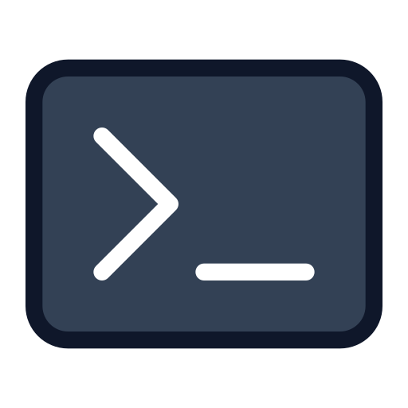

# Wetty

**Category:** Development
**Type:** Workload Template
**Tags:** `development` · `workload`
**Compatibility:** `genesis-deployment>=1.5.0` · `orion-deployment>=1.5.0`

---

## Overview

Wetty (Web + tty) provides a terminal emulator accessible directly from the browser over HTTP/HTTPS. It gives users a full interactive shell in their project environment without requiring SSH access or a desktop environment. The Wetty workload template lets users launch browser-based terminal sessions directly from Genesis, with support for custom packages and an optional public access mode.

---

## How It Works

**Workload Template** — Installs the Wetty workload schema into Genesis. Once installed, the Wetty type appears in **Genesis** on the Workloads page, where it can be authored into a workload template. Users can then launch and provision browser-accessible shell sessions on demand within a project through **Hubble**.

**Access and authentication** — Each terminal runs with an nginx sidecar in the same pod. The ingress routes `/<namespace>/wetty/<workload-name>/` to the sidecar, which checks the user's Hubble login before forwarding the request to Wetty. Because authentication happens inside the pod rather than through ingress-controller annotations, it works the same with any ingress controller (ingress-nginx, Traefik, etc.).

---

## Prerequisites

- Platform versions: `genesis-deployment >= 1.5.0`, `orion-deployment >= 1.5.0`

---

## Installation

1. Open **Terra** and navigate to the **Plugin Marketplace**
2. Search for **"wetty"**
3. Click **Install**
4. Click **Confirm** to deploy (no install-time fields required)

Once installed, the Wetty schema is available in **Genesis**. From the Workloads page, author the template — users can then launch and provision terminal sessions on demand through **Hubble**.

---

## Configuration

### Install-Time Fields

No install-time configuration is required for this plugin.

### Workload Launch Fields

These fields are configured when authoring the workload template in **Genesis** and used each time a user provisions a terminal session through **Hubble**:

| Field | Details |
|-------|---------|
| `registry` | **string** · Required · Default: `wettyoss` Container registry for the Wetty image |
| `repo` | **string** · Required · Default: `wetty` Wetty image repository |
| `tag` | **string** · Required · Default: `2.5` Wetty image tag |
| `packages` | **string** · Optional · Default: `vim` Space-separated list of additional packages to install at startup |
| `ingressClassName` | **string** · Optional · Default: `""` IngressClass for the terminal's ingress (e.g. `nginx`, `traefik`). Leave empty to use the cluster's default IngressClass |
| `nginx_registry` | **string** · Required · Default: `docker.io` Container registry for the nginx proxy image |
| `nginx_repo` | **string** · Required · Default: `nginx` nginx proxy image repository |
| `nginx_tag` | **string** · Required · Default: `1.29.3` nginx proxy image tag |
| `publicAccess` | **boolean** · Required · Default: `false` Disable the Hubble login check and allow unauthenticated browser access to the terminal |
| `ingressNamespace` | **string** · Required · Default: `ingress-nginx` Namespace the ingress controller runs in. The terminal's NetworkPolicy only accepts traffic from this namespace — set it to your controller's namespace (e.g. `traefik`, or `kube-system` on k3s) |

### Custom Environment Variables

Wetty is a plain tmux/bash shell rather than an application with its own configuration surface — Genesis lets you add arbitrary environment variables to the workload, and these are commonly useful for anything run in the terminal session:

| Variable | Description |
|----------|--------------|
| `TZ` | Timezone for the shell session, e.g. `America/New_York`. |
| `EDITOR` | Default text editor invoked by CLI tools (e.g. `vim`, `nano`). |

---

## Notes

- Setting `publicAccess` to `true` gives a shell to anyone who has the URL — use only in isolated or trusted network environments
- If your cluster uses an ingress controller other than ingress-nginx, update `ingressNamespace` to match; otherwise, on clusters that enforce NetworkPolicy, the terminal will be unreachable
- If `ingressClassName` is left empty and the cluster has no default IngressClass, the terminal will be unreachable — set it explicitly in that case
- The `packages` field installs system packages via `apk` (Alpine) at workload startup; include any CLI tools your terminal users need
- Wetty is ideal for quick shell access and running scripts within a project environment
